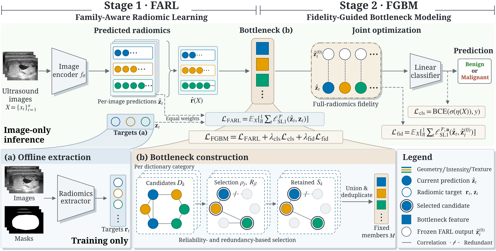
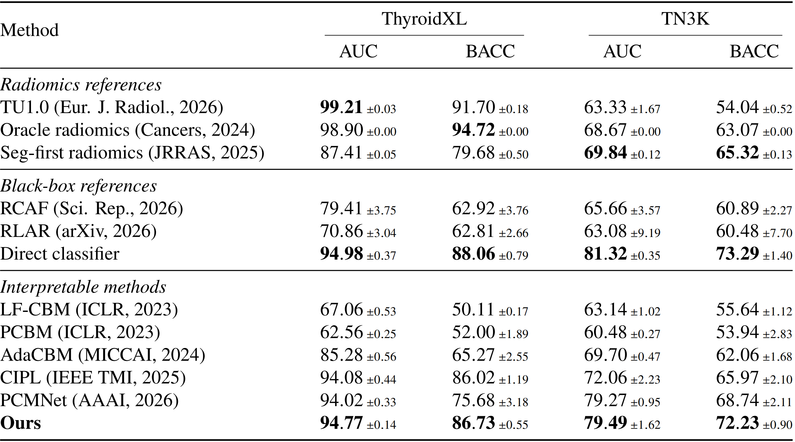

# Learning to Measure and Diagnose: A Clinical-Dictionary Radiomic Bottleneck Model for Thyroid Nodule Classification

[](https://arxiv.org/abs/2610.29738)

Implementation of Learning to Measure and Diagnose, a radiomic bottleneck model for thyroid nodule classification.

## Method



- **Family-Aware Radiomic Learning (FARL):** ConvNeXt-T predicts 102 radiomic
  features with equal loss weight across geometry, intensity, and texture.
- **Fidelity-Guided Bottleneck Modeling (FGBM):** selects dictionary-supported
  features by measurement reliability and redundancy, then jointly refines
  the network and linear classifier under measurement and anchor losses.
- **Decision evidence:** signed feature contributions are grouped by
  dictionary category and, together with the intercept, reconstruct the logit.
  Category contributions are not clinical-sign predictions or TI-RADS scores.

## Results



Test AUC (mean ± SD, three seeds):

Ours has the highest mean AUC among the evaluated interpretable methods.
Direct classification remains ahead by 0.0021 on ThyroidXL and 0.0183 on
TN3K. TN3K uses retrospective within-cohort evaluation.

## Data

Download the two public cohorts and place them under `data/`:

- **ThyroidXL** — HuggingFace dataset [`hunglc007/ThyroidXL`](https://huggingface.co/datasets/hunglc007/ThyroidXL)
  (4,093 patients / 11,545 images, access-gated, ~6.9 GB) → `data/ThyroidXL/`
- **TN3K** — released with [TRFE-Net](https://github.com/haifangong/TRFE-Net-for-thyroid-nodule-segmentation)
  (3,493 images + masks, download links in the README) → `data/TN3K/`
- **TU1.0 radiomics workbook** — [Dictionary-Version-TU1.0](https://github.com/MohammadRSalmanpour/Dictionary-Version-TU1.0) → `data/TN3K/metadata/TU1.0_S1.xlsx`

Data preparation:

```bash
bash scripts/prepare_data.sh --dataset thyroidxl
bash scripts/prepare_data.sh --dataset tn3k
```

Raw roots default to `data/`. Override with `CBM_DATA_ROOT` or
`CBM_TU10_WORKBOOK` if the datasets live elsewhere.

## Training

```bash
conda env update -f environment.yml
conda activate radiomics
pip install -e .
bash scripts/run_ours.sh --dataset thyroidxl --device cuda:0   # Ours, seeds 42/43/44
```

`run_ours.sh` runs three-seed OOF cross-fitting, bottleneck selection,
80-epoch FARL training, and 20-epoch FGBM refinement. Outputs are written to
`experiments/ours/<dataset>/`.

## Acknowledgements

This work uses the public ThyroidXL and TN3K thyroid-ultrasound datasets.
We thank their authors for releasing them.

```bibtex
@inproceedings{duong2025thyroidxl,
  title     = {ThyroidXL: Advancing Thyroid Nodule Diagnosis with an Expert-Labeled, Pathology-Validated Dataset},
  author    = {Duong, Viet Hung and Vu, Huan and Phan, Huong Duong and Nguyen, Duc Quyen and Pham, Duc Hao and Le, Quang Toan and Nguyen, Ba Sy and Do, Tien Dung and Dinh, Viet Sang and Nguyen, Tien Cuong and Pham, Huy Hoang and Ngo, Dien Hy},
  booktitle = {MICCAI},
  year      = {2025},
  doi       = {10.1007/978-3-032-05182-0_60}
}
```

```bibtex
@article{gong2023thyroid,
  title   = {Thyroid region prior guided attention for ultrasound segmentation of thyroid nodules},
  author  = {Gong, Haifan and Chen, Jiaxin and Chen, Guanqi and Li, Haofeng and Li, Guanbin and Chen, Fei},
  journal = {Computers in Biology and Medicine},
  volume  = {155},
  pages   = {106389},
  year    = {2023}
}
```

## Citation

If you find this work useful, please cite the [arXiv preprint](https://arxiv.org/abs/2610.29738):

```bibtex
@article{zhang2026learning,
  title   = {Learning to Measure and Diagnose: A Clinical-Dictionary Radiomic Bottleneck Model for Thyroid Nodule Classification},
  author  = {Zhang, Guibin and Luo, Weier and Cao, Lei},
  journal = {arXiv preprint arXiv:2610.29738},
  year    = {2026},
  url     = {https://arxiv.org/abs/2610.29738}
}
```
